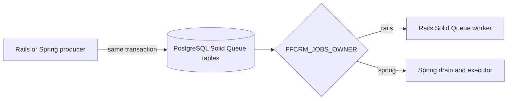

# AB-273: Peripherals (exports, settings/i18n, jobs/mail)

- **Status**: Proposed
- **Ticket**: [AB-273](https://cog-gtm.atlassian.net/browse/AB-273) (epic AB-261)
- **ARB ticket**: TO BE CREATED

Each AB-273 track appends one `## Track:` section below.

## Track: exports

### Context

Rails exports every entity list as CSV and XLS through `respond_to` branches on the index actions
(`app/controllers/entities/accounts_controller.rb:17-18` and the campaigns/contacts/leads/opportunities
equivalents), tasks (`app/controllers/tasks_controller.rb:19-20`) and the activity dashboard
(`app/controllers/home_controller.rb:19`, routed as `/activities`). Spring must serve the same documents from
the AB-270 list endpoints so the gateway can move export traffic without changing what users download.

### Decision

1. **Negotiation without touching AB-270 controllers.** `com.fatfreecrm.api.ExportsController` maps the same
   list paths (`/api/v1/{accounts,campaigns,contacts,leads,opportunities,tasks,activities}`) with
   `produces = {text/csv, application/vnd.ms-excel, application/vnd.msexcel}`; Spring picks it only when the
   request asks for an export, otherwise the JSON read controller answers. `ExportContentNegotiationConfig`
   registers a `ParameterContentNegotiationStrategy` (`format=csv|xls`, registered extensions only, unknown
   values ignored) ahead of the `Accept` header strategy. `.csv` / `.xls` suffix paths mirror the Rails URLs.
2. **Same rows as Rails: full list.** `EntitiesController#get_list_of_records`
   (`app/controllers/entities_controller.rb:138-178`) applies `params[:query]` (139), text + tag parsing (141,
   154-155), Ransack `distinct: true` (146), the session state filter unless `q` is present (148-152), the
   user's `<controller>_sort_by` preference or model default unless `q` is present (157-161), and paginates
   only when the format is not XLS/CSV (165-173). `ExportService` reuses `CrmQueryService` (AB-268 access
   policy + AB-269 search/sort; the AB-270 list filter parameters `category` (accounts), `status` (campaigns, leads) and `stage` (opportunities) stand in for the Rails session filter) and pages
   through every result (page size 200) so the export is the whole accessible, filtered, sorted list.
   Tasks reuse `TaskReadService` buckets (view `pending|assigned|completed`), activities reuse
   `ActivitiesReadService` (same user/duration filters and authorization as the JSON activity list).
3. **CSV = `FatFreeCRM::ExportCSV`.** Columns are the physical table columns in ActiveRecord order, minus
   `/password|token/` (`lib/fat_free_crm/export_csv.rb:20`) and the AB-271 `custom_fields` column (Rails
   ignores it via `ignored_columns`), plus `tags` space-joined for taggable models (21, 26-27). Physical `cf_*`
   columns are included raw. Values use Ruby `to_s`: nil → empty, `true/false`, `YYYY-MM-DD HH:MM:SS UTC`
   timestamps, `BigDecimal#to_s` (`1000.5`, `0.0`), YAML arrays as Ruby `inspect`. Ruby CSV dialect: comma,
   quote only when needed, `""` escaping, `\n` line endings, no BOM, zero-byte body for no rows.
   `Content-Disposition: attachment; filename=<controller>.csv` (`lib/fat_free_crm/renderers.rb:8-12`).
4. **XLS = SpreadsheetML XML**, not binary (`app/views/layouts/header.xls.builder`,
   `app/views/*/index.xls.builder`), so no Apache POI. `SpreadsheetMlWriter` reproduces the builder output
   byte-for-byte: namespaces, `Worksheet`/`Table` wrappers even for empty lists, per-entity en-US headers
   (`ExportHeaders`), custom-field labels/values appended, `ss:Type="Number"` only for numeric values,
   worksheet `Dashboard` for activities. Content type `application/vnd.msexcel; charset=utf-8`
   (`config/initializers/mime_types.rb:6`), no `Content-Disposition` (Rails sends none).
5. **Never exported:** `custom_fields`, `password|token|salt` columns, and activity user secrets (the Rails
   `/activities.json` leak is not reproduced; activities export only the builder's columns).
6. **Atom/RSS/XML stay on Rails** (settled decision: deprecated pending production log confirmation). No Spring
   route produces them; `RailsExportGoldenTest` asserts `Accept: application/atom+xml|application/rss+xml|
   application/xml` never reaches `ExportsController`.

### AB-272 reconciliation

| Contested rule | Selected behavior | Rails-golden evidence |
| --- | --- | --- |
| Model registrations and options | Keep the deduplicated union of the Rails declarations, including User, Address, AccountContact, and AccountOpportunity; ignored and related attributes match their Rails models. | `User/create/69123/68999`, `Address/create/69079/68999`, `AccountContact/create/69056/68999`, `AccountOpportunity/create/69067/68999` |
| List values in `object_changes` | Preserve nested YAML sequences for list-valued attributes; creates use plain arrays in `object_changes`, while assigned update object snapshots use `RubyTagList`. | `Account/create/69001/68999`, `Account/update_tag_list/69134/68999`, `Account/update_tag_list_existing/69136/68999`, `Account/destroy_tagged/69137/68999`, contracts `accounts-create-tag-list` and `account-update-tag-list` |
| Shared timestamp anchors | Generic anchors follow object identity; equal `created_at`/`updated_at` values in `object_changes` use Rails' dedicated shared-UTC alias rule. Other equal-valued distinct timestamps remain unanchored. | `Account/create/69001/68999`, distinct update times in `Account/update/69003/68999`, and serializer tests for shared versus distinct identities |
| YAML scalar quoting | Keep Psych-compatible single/double-quote selection and the public `PaperTrailYaml.quote` entry point used by admin YAML. | `Account/create/69001/68999`, `Campaign/create/69012/68999`, `Contact/create/69045/68999`, `Address/create/69079/68999` |
| Create defaults | Omit values equal to the database column default; use `ColumnDefaults` when no caller default is provided. | `Account/create/69001/68999` |
| BigDecimal precision | Derive the Ruby 9-digit-word precision rather than hardcoding a prefix. | `Account/create/69001/68999` (`36:`) and the zero/tiny-negative serializer unit cases |
| Assigned update ordering | Emit changed assigned attributes first, then remaining columns; keep `object_changes` column-ordered. | Fresh `Account/update/69003/68999` versus materialized `Account/update_materialized/69011/68999` |
| Tag-list update/destroy snapshots | Keep `RubyTagList` in assigned update snapshots, plain nested lists in `object_changes`, and `[]` as the before value when a fresh request assigns `tag_list`. A fresh destroy request leaves the virtual attribute nil even when database taggings exist; an in-memory object that already holds an assigned `TagList` retains it through destroy. | `Account/update_tag_list/69134/68999`, `Account/update_tag_list_and_name/69135/68999`, `Account/update_tag_list_existing/69136/68999`, `Account/destroy_tagged/69137/68999`, `Contact/update_tag_list/69138/68999`, contracts `accounts-create-tag-list`, `accounts-destroy`, and `account-update-tag-list` |
| Touch rows | Preserve Rails' NULL `object_changes` for forced touch versions. | `Task/touch/69118/68999`; the Rails fixture covers touch for every declared model |

The AB-272 write overloads, `leadUnchangedAssigned`, entity attribute
mappings, and create/update/destroy call shapes remain available to the merged
write services. `CaseLoader` retains both typed HTTP setup requests and SQL
fixture setup statements.

### Tests and gates

- `rake ffcrm:migration:export_goldens` (`lib/tasks/ffcrm/export_goldens.rake`) seeds a fixed corpus inside a
  rolled-back transaction on a frozen clock, drives the real Rails controllers (39 cases: 7 families × CSV/XLS,
  admin/alice/bob, query, tag, Ransack, session filter, pagination-ignored, empty, private records, custom
  fields) and writes `spring/src/test/resources/exports/`. `spec/lib/tasks/export_goldens_spec.rb` checks it is
  deterministic, leaves the DB unchanged and matches the committed files.
- `RailsExportGoldenTest` replays each case through Spring three ways (`Accept`, `format=`, suffix) comparing
  status, content type, `Content-Disposition` and body byte-for-byte; the only normalization is the activity
  timestamps (seeded relative to now).
- CI job `export-goldens` (appended to `.github/workflows/spring-api.yml`) regenerates the goldens and fails on
  drift, mirroring `search-matrix`.
- Contract cases `spring/src/contractTest/resources/contract/cases/ab-273-exports.yml` (14, `compare: text`).
- Gateway: disabled `Spring routing: exports` block matching only
  `^/api/v1/(accounts|campaigns|contacts|leads|opportunities|tasks|activities)\.(csv|xls)$`; `Accept`/`format=`
  exports on the bare list paths follow the per-family blocks.

### Foundation extensions

- Contract harness (authorized by the ticket): per-side `accept` (`ContractCase.SideRequest.accept`, sent by
  `ContractClient`, default still `application/json`) and case-level `compare: text` (`ContractCase.bodyCompare`,
  `ContractDiffer` exact body compare reporting `TEXT_BODY` at `/line/<n>`), unit-tested in
  `ContractTextBodyTest`. Existing cases are unaffected.
- New `ExportLookupRepository` (read-only JDBC lookups for tag names, user/campaign/lead/account names and
  addresses); no foundation class was modified. No new dependency.

### Deviations

- Atom/RSS/XML are not ported (see decision 6), contrary to the ticket text.
- Spring accepts the IANA-style `application/vnd.ms-excel` as well as Rails' registered
  `application/vnd.msexcel`, and always answers with the Rails content type.
- Unauthenticated/forbidden exports return RFC 9457 problem+json (existing `error-body-problem-json`
  allow-list entry), not Rails' `401 text/csv`.

### ARB triage

ARB triage: ARB_REQUIRED (manual review; the detector's T3 hits are `http://acme.test` fixture data and its T7
hits are contract-case paths, both false positives).
Triggers:
- T4 New sync contract: CSV/XLS representations on the `/api/v1` list endpoints (`ExportsController`).
- T6 Network boundary: disabled-by-default gateway block `exports` in `spring/gateway/nginx.conf`.
Not triggered: T1, T2, T3, T5, T7, T8, T9 (same service, data store and JWT boundary; no new dependency).
Required next steps: covered by this ADR; ARB ticket TO BE CREATED.
## Track: jobs-mail


### Context

The Rails application owns asynchronous mail delivery, periodic background
jobs, account enrichment, and IMAP polling. Moving the API runtime to Spring
without an explicit owner boundary could send duplicate mail, ingest the same
message twice, or run two enrichment pipelines. Rails behavior was inventoried
in `app/models/observers/entity_observer.rb:524-549`,
`app/models/polymorphic/comment.rb:24-71`,
`app/models/entities/account.rb:86-87`,
`app/mailers/{user_mailer,subscription_mailer,dropbox_mailer,devise_mailer}.rb`,
`app/views/{user,subscription,dropbox}_mailer/`,
`lib/fat_free_crm/mail_processor/{base,dropbox,comment_replies}.rb`,
`app/jobs/account_website_job.rb`,
`app/services/wikidata_service.rb`, and `db/schema.rb` (Solid Queue tables).

### Decision

Add the Spring jobs/mail/IMAP track behind `FFCRM_JOBS_OWNER`, defaulting to
`rails`; only `spring` ownership starts Quartz, connects to IMAP, schedules
one-off work, or delivers mail. Quartz recurring jobs use RAMJobStore and
PostgreSQL session advisory locks (`classid=1179009869`, `objid=1` Dropbox,
`2` comment replies, `3` Solid Queue drain). The Solid Queue bridge claims
supported work from the existing Rails tables in bounded batches; unknown job
classes are left ready. One-off jobs contain primitive IDs or serialized mail
fields only. The website and Wikidata clients use JDK `HttpClient`, Jsoup, and
Jackson with no automatic redirects, bounded timeouts and response size, and
optional private-address blocking disabled by default.

Mail template rendering is isolated from the Spring MVC Thymeleaf view
configuration. Mail settings resolve database-backed Rails values before the
Spring YAML defaults. IMAP drops attachments, follows Rails message validity,
sender and archive/discard rules, and records comment create versions. The
reply parser ports `email_reply_parser_ffcrm` 0.5.0; its upstream MIT license
and fixture emails are shipped with the JUnit goldens. Rails generates the
sorted JSON parity fixtures through `rake ffcrm:migration:mail_golden`.

### Write callbacks and queue bridge

| Rails callback/source | Spring path | Status |
| --- | --- | --- |
| `EntityObserver#after_create/#after_update` (`app/models/observers/entity_observer.rb:11-28`) | `RailsModelCallbacks` called from `EntityWriteService`, nested account/lead promotion, `CommentWriteService`, `DropboxProcessor`, and enrichment jobs | parity: Rails drops (Integer whodunnit) — see follow-up; mail processors use String IDs; jobs use nil; Campaign excluded |
| `Comment#after_create :subscribe_user_to_entity, :notify_subscribers` (`app/models/polymorphic/comment.rb:35,48-58`) | `CommentWriteService` and `CommentRepliesProcessor` call `CommentNotificationService` after subscription | Wired; PostgreSQL's unordered `WHERE id IN (...)` recipient order is retained |
| Account `after_save_commit` (`app/models/entities/account.rb:86-87`) | `RailsModelCallbacks` → `AccountEnrichmentTrigger` from entity writes, comments, mail processors, and both enrichment jobs | Wired for website-first, Wikidata-only, and chained saves |
| `Setting.host` precedence (`app/models/setting.rb:55-65`, `config/settings.default.yml`) | `MailSettingsService.host()` | Wired; database, YAML, then Spring default |
| Mail processor whodunnit (`lib/fat_free_crm/mail_processor/base.rb:166`) | Callback calls in `CommentRepliesProcessor` and `DropboxProcessor` with sender ID | Wired; enrichment job saves use nil whodunnit |

#### Follow-up: assignment mail on web writes

The Rails `EntityObserver` currently drops assignment mail on authenticated web
writes. `ApplicationController` calls `set_paper_trail_whodunnit`
(`app/controllers/application_controller.rb:13`), and PaperTrail's default
`user_for_paper_trail` returns `current_user.try(:id)` (in
`paper_trail/frameworks/rails/controller.rb:26-29`), an Integer. The
observer's `current_user` resolver accepts a `User` or String ID only
(`app/models/observers/entity_observer.rb:30-37`), so an Integer resolves to
nil and the `current_user.present?` mail gate fails. The existing observer spec
stubs `PaperTrail.request.whodunnit` to return a User object
(`spec/models/observers/entity_observer_spec.rb:13`), hiding the web-write
behavior. Spring now preserves the Ruby whodunnit type at each boundary:
web writes use Integer and enqueue no assignment mail, mail processors use
String sender IDs and can enqueue it, and jobs use nil.

Spring writes Rails-compatible Active Job envelopes directly into
`solid_queue_jobs` and `solid_queue_ready_executions` through
`RailsJobEnqueuer`, using the same PostgreSQL database and caller transaction.
The existing owner switch selects the consumer: Rails when owner is `rails`,
or Spring's `SolidQueueDrainService` and `SolidQueueJobExecutor` when owner is
`spring`. This adds no queue store, database, vendor, or runtime dependency.
T4 applies: Spring inserts Active Job rows into Rails Solid Queue tables,
creating a cross-runtime asynchronous contract. The insertion uses the existing
shared PostgreSQL database and adds no new store or vendor.



### Queue bridge NFR and controls

- Availability and recovery inherit the existing PostgreSQL/Solid Queue service
  targets and backups; this ADR does not establish new numeric SLO or RPO
  targets. Confirm the existing targets before changing ownership.
- Each notification or enrichment request adds a job row and ready-execution
  row. The Spring drain remains batch-bounded; monitor queue growth and drain
  latency during cutover.
- Job arguments contain Rails-compatible model GlobalIDs and job metadata,
  classified and retained under the existing CRM database controls. They do not
  contain mail bodies, SMTP/IMAP credentials, or new customer data categories.
- Producers use the existing PostgreSQL connection and transaction boundary;
  no new database, network endpoint, or credential is introduced. Do not log
  job arguments or credentials.
- Incremental infrastructure/vendor cost is zero; database storage and I/O
  scale with queued work. The application runtime team owns the owner switch
  and rollback runbook in this ADR's Operations section.

Devise confirmation/reset/password-change mail ownership remains an open
question; this callback wiring does not add new Devise mail producers.

### Alternatives

- Keep Rails as the sole owner permanently: safest initial deployment, but
  leaves background work outside the Spring migration.
- Use a persistent Quartz store: increases schema and recovery coupling; the
  agreed design uses RAMJobStore and documents one-off restart loss.
- Share IMAP folders or rely only on scheduler timing: cannot guarantee
  single-owner processing; PostgreSQL session locks are used for recurring
  polls.

### Dependencies

Spring Boot Mail, Thymeleaf, Quartz, Jsoup 1.21.x, and test-only GreenMail
2.1.x; PostgreSQL is the shared lock and Solid Queue store. Java `HttpClient`
and Jackson are already available. Resolved dependency versions are recorded
with the implementation verification report.

### NFR and security

No new endpoint or database is introduced. Jobs use bounded HTTP request sizes
and timeouts, no redirects, and an opt-in private-address block. SMTP and IMAP
credentials remain in the existing Rails settings/configuration sources and
must be supplied through deployment secrets; never place credentials in
goldens or logs. The owner switch and advisory locks prevent concurrent
side-effects. One-off RAMJobStore work is intentionally at-most-process-life.

### Operations and rollback

1. Deploy with `FFCRM_JOBS_OWNER=rails`; confirm Spring has no Quartz polling
   and Rails remains the only producer/consumer.
2. Configure Spring SMTP/IMAP settings, schedules, and external service access.
3. Stop Rails job/IMAP workers, change the Spring deployment to
   `FFCRM_JOBS_OWNER=spring`, and verify scheduler logs and mail inbox health.
4. Roll back by setting `FFCRM_JOBS_OWNER=rails` and restarting Rails workers.
   The Spring owner gate then prevents scheduled side effects.
5. Check failed Solid Queue rows and rerun any one-off work lost across a
   Spring restart; recurring schedules are registered on startup.

The Rails IMAP constructor at
`lib/fat_free_crm/mail_processor/base.rb:71` uses the deprecated positional
`Net::IMAP.new(host, port, ssl)` form; installed `net-imap` 0.6.3 still accepts
it. Its shared permission check uses `Permission.exists`; the Spring
implementation uses the existing permission repository. The en-US Rails mail locale is
`config/locales/fat_free_crm.en-US.yml`; Devise strings come from the Devise
gem because no `config/locales/devise.en-US.yml` exists.

### Operations addendum

#### Context and decision

Rails ownership remains the default. Spring can take ownership through
`FFCRM_JOBS_OWNER=spring` only after the Rails cron and Solid Queue workers are
stopped. The inventory is `UserMailer`
(`app/mailers/user_mailer.rb:9-23`, trigger `app/models/observers/entity_observer.rb:9-28`),
subscription mail (`app/mailers/subscription_mailer.rb:9-35`,
`app/models/polymorphic/comment.rb:34-71`), Dropbox rendering
(`app/mailers/dropbox_mailer.rb:9-19`), the website/Wikidata jobs and the three
IMAP processor files under `lib/fat_free_crm/mail_processor/`.

Quartz is used for scheduling rather than JobRunr to keep the already selected
Spring scheduler integration small. Quartz RAMJobStore is selected over JDBC
JobStore because this bridge's scheduled work is restart-loss tolerant and
should not introduce another durable scheduler schema. A single owner gate is
preferred to dual-running Rails and Spring, which could duplicate mail, IMAP
processing and enrichment. Spring drains supported Solid Queue rows rather
than leaving the Rails worker active in parallel; unsupported classes remain
ready for Rails.

Quartz, Spring Mail, Thymeleaf, Angus Jakarta Mail, Jsoup, GreenMail and the
vendored reply parser are the selected components. Gradle resolves Spring Boot
3.5.16, Thymeleaf 3.1.5.RELEASE, Angus Jakarta Mail 2.0.5, Jsoup 1.21.2 and
GreenMail 2.1.3; `email_reply_parser_ffcrm` is vendored at 0.5.0 (MIT).

Cutover: stop Rails Dropbox/comment-reply cron; stop Solid Queue workers and
dispatcher and verify no claimed executions remain; set `FFCRM_JOBS_OWNER=spring`;
restart Spring; verify scheduler startup, advisory-lock acquisition and
queue-drain logs. Rollback sets the owner to `rails`, restarts Spring with
scheduling disabled, drains pending RAMJobStore one-offs, restarts Rails queue
workers and re-enables cron.

Deviations: MailText is en-US only pending settings-i18n; Devise token
generation remains Rails-owned; update/touch versions await the audit track;
attachments are ignored; and SSRF private-address blocking is disabled by
default for parity. Dropbox notification rendering remains available, but its
Rails caller is dead and Spring does not send it. SMTP/IMAP credentials remain
in existing Rails settings and are never emitted in logs or goldens; response
bodies are bounded and redirects are not followed.

### Architecture review (jobs-mail)

ARB triage: ARB_REQUIRED
The detector (`detect_arb_triggers.py --base afd3e4b`) returned ARB_LIGHT
from one T3 URL in `MailRendererGoldenTest`; that is fixture data and not a
new outbound integration. Manual review adds T4: Spring writes Rails-compatible
Active Job rows into the shared Solid Queue tables, creating a new cross-runtime
asynchronous contract even though PostgreSQL is already shared and there is no
new store or vendor.

Not triggered for this callback/queue change: T1, T2, T3, T5, T6, T7, T8, T9.
Required next steps: this ADR records the decision and controls; create an ARB
ticket and obtain review before changing production queue ownership.
ARB ticket: TO BE CREATED
## Track: settings-i18n

### Context

Spring needs Rails' `Setting[...]` values (locale selection now; mail, facets and validations in
later tracks) and the app's translation catalog, with identical results while both apps share the
PostgreSQL `settings` table. Rails ground truth:

- `app/models/setting.rb:55-65` `Setting[name]`: per-request cache → first `settings` row whose
  deserialized value is `present?` → `yaml_settings[name]` → nil. A blank DB value (nil, false, "",
  whitespace, [], {}) falls through to YAML; any other DB value replaces the YAML value wholesale.
- `app/models/setting.rb:114-117` + `lib/fat_free_crm/load_settings.rb:14-19`: `yaml_settings` is
  `config/settings.default.yml` deep-merged (`deep_merge!`: Hash+Hash recurses, anything else —
  including nil/false and arrays — replaces) with optional `config/settings.yml`, as a
  `HashWithIndifferentAccess`.
- `app/controllers/application_controller.rb:109-111` clears the cache every request;
  `:116-119` picks the user's `locale` preference, else `Setting.locale`.
- `settings.value` is Psych YAML (`serialize :value`), loaded with the permitted classes in
  `config/application.rb:87-99`; other `!ruby/object` classes raise `Psych::DisallowedClass`.
- `config/initializers/locale.rb:15-19`: i18n fallbacks on; `I18n.fallbacks[:en] = [:"en-US"]`.

Locale inventory (the Jira text says "30+"): **18 app-owned locales** in
`config/locales/fat_free_crm.*.yml` (the locale is each file's top-level key, e.g.
`fat_free_crm.de-DE.yml` → `de`). Rails' `I18n.available_locales` reports 134 because gems add
their own files: rails-i18n 8.1.0 (287 files, 123 locales), devise-i18n 1.15.0 (72 files,
72 locales) and other gems (57 files, 33 locales) — counts captured in `rails_i18n_matrix.json`
`load_path_census`.

### Decision

1. **Settings tiers.** `com.fatfreecrm.service.settings.SettingsService` (config
   `ffcrm.settings.*`, `SettingsProperties`) resolves exactly like `Setting[]`: DB row present →
   wins wholesale; otherwise the YAML tier = classpath `settings/settings.default.yml` (byte copy of
   the Rails file, enforced by Gradle `verifySettingsDefaults` in `check`) deep-merged with the
   optional `${FFCRM_SETTINGS_FILE}` overrides (missing file ignored like `File.exist?`; ERB fails
   startup because Spring cannot evaluate it). Map keys are normalized to indifferent access; Ruby
   symbols stay `":name"` strings. Duplicate rows resolve to the lowest id. Read-only: Rails remains
   the writer of `settings`.
2. **Bounded staleness.** The DB tier is a snapshot of the whole `settings` table refreshed lazily
   when older than `ffcrm.settings.cache-ttl` = **30s** (same value as the AB-271 custom-field
   registry). A Rails admin change becomes visible to Spring within 30s. Resolved values are
   memoized per snapshot, so the bound holds for every key.
3. **YAML and JSON values.** `SettingValueCodec` reads both: `---` documents and non-JSON text via
   `RailsYaml`, strict JSON via Jackson; `!ruby/<kind>:<Class>` tags outside the Rails permitted list
   are rejected (row treated as absent, logged by name/id only).
4. **YAML→JSON conversion for AB-274.** Not run while Rails runs. Profile `convert-settings-json`
   (`SettingsJsonConversionRunner` → `SettingsJsonConversion`) converts each non-JSON row, verifies
   the JSON decodes to the same value, and writes with
   `UPDATE settings SET value = ? WHERE id = ? AND value = ?` (concurrent-change guard). Dry run is
   the default; a real run also needs `confirm-rails-stopped=true`; re-runs are no-ops; any failed
   row → non-zero exit. The profile boots the full context on an ephemeral loopback port
   (`server.port: 0`), because `SecurityConfig` needs a servlet context. It therefore needs the
   API's `FFCRM_DB_*` and `FFCRM_JWT_SECRET`.

   Cutover runbook, with Rails stopped:
   1. Back up: `CREATE TABLE settings_yaml_backup AS SELECT id, name, value FROM settings;`
   2. Dry run: `java -jar spring/build/libs/fat-free-crm-api-0.1.0-SNAPSHOT.jar --spring.profiles.active=convert-settings-json`,
      then review the report.
   3. Convert by adding `--ffcrm.settings.conversion.dry-run=false
      --ffcrm.settings.conversion.confirm-rails-stopped=true`.
   4. Rollback to Rails **requires the restore**:
      `UPDATE settings s SET value = b.value FROM settings_yaml_backup b WHERE s.id = b.id;`
      Rows created after the conversion are not in the backup, so review them first.

   **What Rails reads from converted rows.** This was verified with `rails runner` on a PG16
   database that the profile had converted. It was seeded through `Setting[]=`; for example,
   `email_dropbox` was stored as `{":server":"imap.example.com",":port":993,":ssl":true,…}`.
   - The reads ran after `Setting.clear_cache!`, which Rails runs before every request
     (`app/controllers/application_controller.rb:109-111`). Booting fills the cache from YAML, so
     a check run without clearing it sees the defaults.
   - Psych loads the JSON without error, but symbols do not survive.
   - `Setting[:email_dropbox]` is a `HashWithIndifferentAccess` keyed by the strings `":server"`
     and so on. `Setting.email_dropbox[:server]` and `Setting.dig(:email_dropbox, :server)`
     return `nil`.
   - `Setting[:background_info]` is `[":account", ":contact"]`, so `include?(:account)` is
     `false`. `Setting.task_bucket.first` is `":due_asap"`, not `:due_asap`.
   - Strings, integers and booleans (`locale`, `host`, `per_user_locale`, …) read back unchanged.

   After the restore SQL, every value matched the backup (0 rows differed) and Rails returned
   symbols again. The CI job `settings-i18n` repeats this cycle: backup, convert, re-run, restore,
   compare.
5. **i18n catalog.** `rake ffcrm:migration:i18n_properties` generates
   `spring/src/main/resources/i18n/messages_<tag>.properties` (UTF-8, flattened dotted keys,
   deterministic) from the 18 app files. Plain strings keep Rails `%{name}` text (Rails interpolates
   only when arguments are passed); plural hashes become ICU
   `{count, plural, =0{…} one{…} few{…} many{…} other{…}}`. Non-string YAML keys (`true`/`false`)
   and nil leaves are skipped because Rails' dotted lookup can't reach them.
6. **`I18nService.t(key, Locale, Map<String,Object>)`** walks the Rails fallback chain and formats
   with **ICU4J** `MessageFormat` using the locale where the key was found (CLDR plural rules).
   Chains are taken from the Rails fixture: `<locale>` → parents → `en`, except `en → [en-US]`
   (configured by `ffcrm.i18n.fallback-defaults` / `fallback-overrides`). A missing argument throws
   `MissingInterpolationArgumentException` (Rails `I18n::MissingInterpolationArgument`); a key
   missing everywhere returns `Translation missing: <tag>.<key>`.
7. **Spring wiring.** `FfcrmMessageSource` (bean `messageSource`) delegates to `I18nService` but
   keeps the `MessageSource` contract (default message / `NoSuchMessageException`, never the Rails
   "Translation missing" text), so problem-detail and Bean Validation output is unchanged. It
   replaces Boot's auto-configured `messageSource`; no `spring.messages` bundle is used in the
   service, and AB-272's ActiveModel messages load their own `validation/` JSON. `FfcrmLocaleResolver`
   (bean `localeResolver`) orders: authenticated user's `locale` preference → `Accept-Language`
   matched to the 18 bundles → `Setting[:locale]` → `en-US`.
8. **Gem locales are not converted.** Spring needs no gem keys today. ActiveModel/validation
   messages belong to AB-272. Date/number/helpers/simple_form/ransack/will_paginate strings are
   rendered only by Rails views (AB-275). Devise strings belong to the Rails login UI.
9. **New dependency:** `com.ibm.icu:icu4j:77.1`. It is the stable ICU release from the Unicode
   Consortium (Unicode-3.0 license), a pure library with no network access and no transitive
   dependencies.
10. **Coverage evidence.** `rake ffcrm:migration:settings_cf_coverage` scans `app/`, `lib/` and
    `config/` for every `Setting.<x>` / `Setting[...]` and `cf_` site and generates
    `docs/migration/settings-cf-coverage.md`, classified by the ordered rules in
    `docs/migration/settings-cf-coverage.rules.yml`. That gives 229 sites: 6 ported, 19 partial,
    184 not ported (each with an owner/reason), and 20 n/a. `CHECK=1` fails on any unclassified
    site or table drift; line-number-only drift only warns.

### Parity and CI

- `rake ffcrm:migration:settings_matrix` → `spring/src/test/resources/settings/rails_settings_matrix.json`
  has 4 tier states (defaults; plus override file; DB overlay on each). The DB rows cover blank
  fall-through, wholesale replace, symbols, numbers, nested hashes, HWIA, JSON and a disallowed
  class. `RailsSettingsParityTest` replays every key and dig.
- `rake ffcrm:migration:i18n_matrix` → `spring/src/test/resources/i18n/rails_i18n_matrix.json`
  holds 6265 `I18n.t` cases across the 18 locales: every plural key at 14 counts, every
  interpolated key, sampled plain keys, en-US fallbacks and missing keys. It also records the
  fallback chains. `RailsI18nParityTest` replays them for exact string equality.
- CI job `settings-i18n` (`.github/workflows/spring-api.yml`) does four things:
  1. Regenerates the properties and fails on any diff.
  2. Runs the coverage `CHECK=1`.
  3. Regenerates both Rails fixtures on postgres:16 and fails on any diff.
  4. Runs the four new specs.

### Known deltas (explicit in the tests)

- `db_bad_class` setting row: Rails raises `Psych::DisallowedClass` (`config/application.rb:87-99`).
  Spring treats the row as absent instead of failing the request.
- Rails results that come from gem-provided translations Spring does not ship (see Decision 8).
  These are tolerated only when Spring has no translation for the key at all. 46 cases.
- pt-BR `pluralize.*` with count 0: rails-i18n's pt-BR rule puts 0 in `other`, while CLDR/ICU4J puts
  it in `one` (rails-i18n `rails/pluralization/pt-BR.rb:3`). 6 cases.
- A plural key called without `count`: Rails returns the raw Hash, but `I18nService` returns a
  String. 7 cases.

`RailsI18nParityTest` pins each delta count, so any new delta fails the build.

### Alternatives considered

- **Spring `ResourceBundleMessageSource` with `java.text.MessageFormat`:** rejected. It has no CLDR
  plural categories (`few`/`many` for ru/pl).
- **Per-request cache clearing like Rails:** rejected. It means a full-table read on every request.
  A 30s TTL bounds staleness at low cost.
- **Converting `settings.value` to JSON now:** rejected by the ticket. Rails keeps writing
  YAML while it runs, so the table would end up with mixed formats. The conversion runs once at
  the AB-274 cutover, after Rails stops writing.

### Deviations

- Jira says "30+ locales". The app owns 18; the rest come from gems (counts above).
- Plain strings keep Rails `%{name}` syntax instead of ICU `{name}`. `I18nService` interpolates them
  Rails-style, because Rails returns the raw string when no arguments are given and the parity
  fixture requires that behavior. Only plural hashes are ICU patterns.

### ARB triage

```
ARB triage: NO_ARB
Triggers:
- (none) The heuristic detector reported T2/T3/T6 hits. All of them are false positives after reading the diff:
  - T2 matched docs/migration/* and lib/fat_free_crm/migration/* file names. That is offline tooling; no
    data store or column is added or changed, and the YAML->JSON conversion only ships as an AB-274 tool.
  - T3 matched the build.gradle.kts dependency block, a locale string mentioning "OpenAI", and a URL in a
    YAML comment. com.ibm.icu:icu4j:77.1 is an offline library with no dependencies, not a vendor or
    network integration.
  - T6 matched a test import of Jwt. FfcrmLocaleResolver only reads the existing security context for
    the locale preference; authn/authz is unchanged.
Not triggered: T1, T2, T3, T4, T5, T6, T7, T8, T9
Required next steps: none. The new dependency is recorded here (Decision 9). Re-triage under AB-274 before
executing the settings conversion against the shared database.
```

## Track: audit

### Context

Rails PaperTrail 16 is the compatibility reference for the shared `versions`
table. Spring must preserve row metadata, PaperTrail YAML values, related-item
metadata, operation ordering, and the Rails reader's ability to deserialize
and reify each Spring-written row. Rails-generated fixtures record declarations,
133 model/operation/whodunnit cases, and seven mail/job sequences. Each model
has a fresh-record update and a fully materialized in-memory update; touch cases
cover every declared model. Rails emits no row for the ignored-only
`AccountContact` touch.

### Decision

- Keep `VersionRecorder` as the single Spring writer. `PaperTrailOptions`
  mirrors Rails `has_paper_trail` declarations; explicit touches use the forced
  touch path and preserve Rails' NULL `object_changes`.
- Rails' `versions.object` ordering follows ActiveRecord attribute materialization:
  changed assigned keys in `assignedOrder` lead the dump, then remaining
  attributes retain column order. Fully materialized records pass an empty
  order and preserve column order. If an ignored assigned attribute is
  materialized before the first changed assigned attribute, as with
  `AccountContact.updated_at`, the golden records an empty order and preserves
  Rails' observed object order. `object_changes` remains column-ordered.
- An explicitly assigned timestamp-only update is notable only when Rails
  goldens show a version row; the `AccountOpportunity` `updated_at`-only case
  pins that behavior. An implicit timestamp-only change remains non-notable.
- Keep audit serializer corrections isolated in `fix(audit):` commits under
  `service/audit/` and its tests. `PaperTrailYaml` derives BigDecimal precision
  in Ruby's 9-digit words, including the verified forms `36:` for the long
  positive decimal, `9:-0.1e-8` for the tiny negative, and `9:0.0` for zero.
- For creates, caller-provided defaults take precedence (including explicit
  null); otherwise `ColumnDefaults` uses the cached table column default.
  Expression defaults such as `nextval` and `now()` remain null.
- `tag_list` is an assigned virtual attribute, not the persisted taggings
  association. Tag-only updates use `[]` as the Rails before value and record
  the update timestamp; create changes use plain lists while update snapshots
  use `RubyTagList`. Fresh HTTP destroy call sites pass nil for the unassigned
  virtual attribute; the recorder retains an explicitly supplied
  `RubyTagList` for a same-instance destroy. The enforced
  `account-update-tag-list` database assertion pins the Rails row.
- Use `RailsRowAttributes` outside `service/audit/` for persisted database
  column order. It excludes `custom_fields`, retains `cf_*`, and converts
  persisted serialized and JDBC temporal values to the types the recorder uses.
- Use Rails goldens as the contract. Exact YAML bytes are required unless an
  individual delta is explicitly allow-listed with a pinned count and rationale.
  Six touch-object anchor-label deltas are accepted for Account, Contact, and
  User cases with and without whodunnit. The decoded object maps are equal; only
  Psych and SnakeYAML's labels for shared timestamp aliases differ.

### Tests and gates

- `ffcrm:migration:audit_goldens` runs transactionally against empty PostgreSQL
  corpus tables with fixed time and IDs. CI runs it twice and checks that the
  Rails fixture directory has no diff.
- `RailsAuditGoldenTest` replays every typed Rails case through `VersionRecorder`,
  checking row attributes, decoded YAML, and exact YAML bytes; its fixture-write
  mode generates `spring_audit_versions.json`.
- `spec/lib/audit/spring_versions_spec.rb` inserts Spring rows and checks Rails
  `object_deserialized`, `reify`, and `changeset` behavior.
- Jobs/mail scenario tests compare Spring row sequences with the Rails scenario
  goldens. The contract harness runs enforced Phase-A writes followed by Rails
  and Spring activity-feed reads for alice and admin.
- `accounts-create-custom-field`, `accounts-update-custom-field`,
  `opportunities-update-won-campaign`, and
  `opportunities-update-unwin-campaign` are enforced without YAML allowlisting
  or normalizer changes.
- The live Rails/Spring contracts `accounts-create-tag-list`,
  `accounts-destroy`, and `account-update-tag-list` assert the `versions` rows;
  `activity-after-task-comment-alice` and
  `activity-after-task-comment-admin` enforce callback ordering and feed parity.
- CI runs the golden task twice, the two Rails compatibility specs, and RuboCop
  on changed Ruby files. The full local gate additionally includes the Spring
  build, reset contract database, and live contract suite.

### Accepted YAML deltas

Six touch-object anchor-label differences are allow-listed and pinned in
`RailsAuditGoldenTest`: Account, Contact, and User, each with and without
whodunnit. Each has equal decoded YAML values; only the anchor labels emitted
for shared timestamp objects differ. All other `object` and `object_changes`
values require byte equality.

### Coverage

| Rails model (declaration) | Rails options | Spring writer |
| --- | --- | --- |
| `Task` (`app/models/polymorphic/task.rb:112`) | related `:asset`; ignore `:subscribed_users` | AB-272 Phase A task writes |
| `Comment` (`app/models/polymorphic/comment.rb:31`) | related `:commentable`; ignore `:state` | AB-272 Phase A comments; CommentRepliesProcessor |
| `Email` (`app/models/polymorphic/email.rb:36`) | related `:mediator`; ignore `:state` | AB-272 Phase A email writes; DropboxProcessor |
| `Address` (`app/models/polymorphic/address.rb:31`) | related `:addressable` | AccountWebsiteJob |
| `AccountContact` (`app/models/entities/account_contact.rb:24`) | related `:contact`; ignore `id`, `created_at`, `updated_at`, `contact_id` | DropboxProcessor |
| `Account` (`app/models/entities/account.rb:68`) | ignore `:subscribed_users` | DropboxProcessor; AccountWebsiteJob; WikidataJob |
| `Campaign` (`app/models/entities/campaign.rb:56`) | ignore `:subscribed_users` | DropboxProcessor keyword create |
| `Opportunity` (`app/models/entities/opportunity.rb:76`) | ignore `:subscribed_users` | DropboxProcessor keyword create |
| `Lead` (`app/models/entities/lead.rb:68`) | ignore `:subscribed_users` | DropboxProcessor |
| `Contact` (`app/models/entities/contact.rb:90`) | ignore `:subscribed_users` | DropboxProcessor |
| `AccountOpportunity` (`app/models/entities/account_opportunity.rb:25`) | none | none |
| `User` (`app/models/users/user.rb:65`) | ignore `:last_sign_in_at` | none |

AB-272 Phase B entity/admin writes remain pending in sibling work. No
`ContactOpportunity` declaration is active in Rails; its declaration is
commented out.

### Deviations

- The Spring Dropbox attachment path records the second account email and
  account touch whenever the contact has an account; Rails gates these effects
  on `attach_to_account`. This is a mail-flow deviation, not an audit serializer
  issue, and is documented rather than changed in this audit track.
- Rails' keyword-based Dropbox asset lookup and notification behavior have
  existing Spring flow differences. The notification caller is unreachable in
  the observed Rails path and Spring does not send it. These are not broadened
  into audit fixes.
- Task-comment activity writes preserve Rails' callback sequence:
  `CommentWriteService.create()` persists and records the Comment before
  `subscribe()` records the Task update. Rails produces the same version-row
  order in `activity-after-task-comment-alice` and
  `activity-after-task-comment-admin`; the feed orders by `created_at DESC`,
  so the later Task update appears first.
- The in-memory `Account/destroy_tagged` golden retains its assigned
  `RubyTagList`; the HTTP `accounts-destroy` contract loads a fresh record and
  Rails records nil for the unassigned virtual `tag_list`, despite persisted
  taggings. Spring's entity destroy audit call follows the fresh-request
  contract behavior.
- Rails `TasksController#update` materializes the loaded Task through `dup` and
  reads `due_at` / `computed_bucket` before `update`
  (`app/controllers/tasks_controller.rb:93-100`), so Spring
  `TaskWriteService.update()` passes an empty `assignedOrder` to match the
  column-ordered Rails snapshot. The complete/uncomplete controller actions
  update directly after loading and do not make those pre-save reads, so their
  assigned-order behavior remains unchanged.
- Activity-feed comparisons mask only generated timestamp keys inside the
  YAML strings; item type, event, row order, and all other object/object_changes
  content remain compared.

### ARB triage

ARB triage: NO_ARB
Triggers: none confirmed. Detector (`detect_arb_triggers.py --base origin/devin/ab-273-peripherals`) reported heuristic hits that were reviewed and rejected:
- T2 `lib/fat_free_crm/migration/activemodel_messages.rb`, `spring/src/test/resources/authz/contract_corpus.sql`: arrive with the AB-272 merge (d705ef38), and neither is a schema change (a Rails message-export helper and a test fixture). This track adds no Flyway migration and no table/column; it writes to the existing `versions` table in the existing PaperTrail format.
- T3 `audit.test` in `lib/tasks/ffcrm/audit_goldens.rake` / `rails_audit_goldens.json`: a reserved test hostname stored as an account `website` value in the golden corpus; nothing calls it. No new vendor, host or runtime dependency. The `spring/build.gradle.kts` change only forwards the `audit.writeFixtures` test system property.
- T7 `contract/allowlist.yml`, `cases/ab-272-writes.yml`: YAML lines the detector misread; no framework or runtime change.
Not triggered: T1, T2, T3, T4, T5, T6, T7, T8, T9
Required next steps: none
