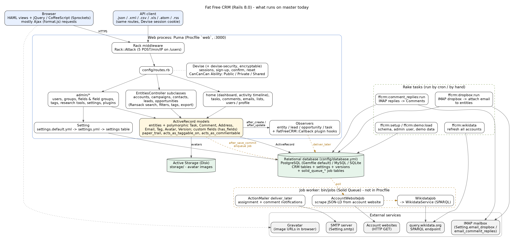

# Fat Free CRM architecture (current state)

This describes what the code on `master` does today: a single Rails 8.0 application
(`fat_free_crm` gem version 0.28.0) that serves server-rendered HTML plus Ajax and data
formats from one set of routes. For the proposed Spring Boot rewrite, see
[migration/target-architecture.md](migration/target-architecture.md); nothing in that
proposal is implemented on `master`.

The diagram source is [`diagrams/architecture.dot`](diagrams/architecture.dot). After editing it,
run `docs/diagrams/render.sh` (needs Graphviz) to regenerate the PNG and SVG.

## Runtime processes

| Process | Started by | What it does |
|---|---|---|
| Web | `Procfile` `web: bundle exec puma -C config/puma.rb` (port `PORT`, default 3000) | Serves every HTTP request. Puma forks `WEB_CONCURRENCY` workers (default 2) outside development. |
| Job worker | `bin/jobs` (Solid Queue CLI) | Runs Active Job jobs. `config/application.rb` sets `queue_adapter = :solid_queue`, so jobs wait in the `solid_queue_*` tables of the main database until a worker runs. The `Procfile` doesn't start a worker. |
| Rake tasks | cron or by hand | Run `ffcrm:dropbox:run` and `ffcrm:comment_replies:run` to poll IMAP. Run `ffcrm:wikidata` to refresh Wikidata data for all accounts. `ffcrm:setup`, `ffcrm:setup:admin` and `ffcrm:demo:load` prepare a new database. |

## Request path

1. **Rack middleware**: `Rack::Attack` (`config/initializers/rack_attack.rb`) throttles `POST /users*` to 5 per minute per IP.
2. **Routing** (`config/routes.rb`): the root is `home#index`. It defines resources for accounts, campaigns, contacts, leads, opportunities, tasks, comments, emails, lists and users, plus an `admin` namespace. Entity resources add `filter`, `advanced_search`, `auto_complete`, `redraw`, `versions`, `attach`/`discard` and `subscribe`/`unsubscribe` actions.
3. **ApplicationController** runs `authenticate_user!` (Devise) on every action except `home#timezone`. It also sets the PaperTrail whodunnit, clears the `Setting` cache, adds `Access-Control-Allow-Origin: *` to every response, and runs `app_before_filter`/`app_after_filter` plugin hooks. `respond_to` serves:
   - `html` for index/show
   - `js` for most actions (the UI is mostly Ajax)
   - `json`/`xml` for everything except edit
   - `atom`/`csv`/`rss`/`xls` for index
4. **Authorization**: CanCanCan (`app/models/users/ability.rb`). Each entity record is `Public`, `Private` or `Shared`; shared access is stored in `permissions` rows for users and groups. Admins can manage everything.
5. **Controllers**:
   - `EntitiesController` subclasses in `app/controllers/entities/` handle the five CRM entities, with Ransack search, saved filters, tags and exports.
   - `HomeController` serves the dashboard and activity timeline (built from `versions`).
   - `Admin::*` controllers manage users, groups, custom fields and field groups, tags, research tools, settings and plugins. The Plugins tab is commented out under `admin_tabs` in `config/settings.default.yml`, so a fresh install doesn't show it, but `/admin/plugins` is still routed.
6. **Views**: HAML templates in `app/views`, with `.js.haml` responses for Ajax and builder templates for XLS and RSS. Assets come from Sprockets (`app/assets`: CoffeeScript, jQuery/jQuery UI, Select2, Bootstrap 5.2 SCSS).

## Domain model

- **Entities** (`app/models/entities/`): `Account`, `Campaign`, `Contact`, `Lead` and `Opportunity`, joined by `AccountContact`, `AccountOpportunity` and `ContactOpportunity`.
  - A lead can be promoted into a contact, plus an optional account and opportunity.
  - Every entity uses `uses_user_permissions`, `acts_as_commentable`, `acts_as_taggable_on :tags`, `has_paper_trail` (class `Version`) and `has_fields` (custom fields).
- **Polymorphic** (`app/models/polymorphic/`): `Task`, `Comment`, `Address`, `Email`, `Avatar` (Active Storage `has_one_attached :image`), `Tag`/`Tagging` and `Version`.
- **Fields** (`app/models/fields/`): `FieldGroup`, `CoreField` and `CustomField` (plus date and datetime pair variants). Admins define custom fields, which add real columns to the entity tables.
- **Users** (`app/models/users/`): `User`, `Group`, `Permission`, `Preference` and `Ability`.
  - Devise modules: `database_authenticatable`, `registerable`, `confirmable`, `encryptable`, `recoverable`, `rememberable` and `trackable`.
  - Sign-up is controlled by `Setting.user_signup` (default `:not_allowed`).
- **Other**: `List` (saved searches), `ResearchTool` (admin-defined lookup links) and `Setting`.
- **Observers** (`config.active_record.observers`): `EntityObserver` emails the assignee when an entity is created or reassigned. `LeadObserver`, `OpportunityObserver` and `TaskObserver` record activity versions.
- **Plugins**: `FatFreeCRM::Callback` hooks and `ActiveSupport.run_load_hooks` let Rails-engine plugins extend controllers, models and views.

## Configuration and storage

- **Database**: there is one relational database, configured in `config/database.yml`, which is git-ignored and copied from one of the `config/database.*.yml` examples.
  - The Gemfile installs `pg` unless both `CI` and `DB` are set: `DB=sqlite` selects `sqlite3` and `DB=mysql` selects `mysql2`. CI uses `CI=1 DB=sqlite`. The `test` group always includes `sqlite3`.
  - `db/schema.rb` holds the CRM tables, `settings`, `versions` and the Solid Queue tables.
- **Settings** load from three layers, later ones winning: `config/settings.default.yml`, then an optional `config/settings.yml`, then the `settings` table, which the admin UI edits. These settings cover the host, SMTP, the IMAP dropbox, comment replies, picklists and more.
- **Files**: Active Storage uses the `Disk` service, `storage/` in development and `tmp/storage` in tests. Image variants use `image_processing` with ImageMagick through `mini_magick`.
- **Caching**: `memory_store` in development, `null_store` in tests. Production doesn't configure a cache store.

## Background work and integrations

| Trigger | Work | External system |
|---|---|---|
| `Account` `after_save_commit` when `website` changes | `AccountWebsiteJob` fetches the site, parses JSON-LD `Organization` data and fills in blank contact, social, geo and address fields. It then enqueues `WikidataJob` if a `wikidata_id` is set. | Account website (HTTP GET) |
| `Account` `after_save_commit` when only `wikidata_id` changes, or `rake ffcrm:wikidata` | `WikidataJob` → `WikidataService` sends a SPARQL query and fills in blank fields | `https://query.wikidata.org/sparql` |
| `EntityObserver`, `Comment` subscriptions, dropbox processing | `UserMailer`, `SubscriptionMailer` and `DropboxMailer` `deliver_later`. Email is only sent when `Setting.host` is set. | SMTP (`Setting.smtp`) |
| `rake ffcrm:dropbox:run` | `FatFreeCRM::MailProcessor::Dropbox` reads an IMAP folder and attaches the emails to matching entities, creating contacts when needed | IMAP (`Setting.email_dropbox`) |
| `rake ffcrm:comment_replies:run` | `FatFreeCRM::MailProcessor::CommentReplies` turns email replies into comments | IMAP (`Setting.email_comment_replies`) |
| Browser rendering of avatars | Gravatar image URLs when no avatar is uploaded | Gravatar |

## Deployment artifacts

- `Dockerfile`: a `ruby:3.4` image that copies `config/database.postgres.docker.yml` to `config/database.yml`, runs `bundle install` in deployment mode and starts `rails s` on port 3000.
- `docker-compose.yml`: `web` plus `postgres:16`, with `RAILS_ENV=production` and `DB_*` environment variables. It starts no job worker.
- `Capfile` and `config/deploy.example.rb`: Capistrano deployment. `Vagrantfile` provides a VM-based setup.
- `.github/workflows/`:
  - `ruby.yml`: RSpec on Ruby 3.4 with SQLite, run on PRs to `master`
  - `rubocop-analysis.yml`, `brakeman-analysis.yml` and `codeql.yml`: static analysis
  - `ghcr-publish.yml`: builds and publishes the image
  - `devin-*.yml`: this fork's webhooks that notify Devin on PR events

## Tests

RSpec specs live in `spec/`, covering models, controllers, views, helpers, routing, mailers, lib, jobs, requests, services and Capybara features.
- `rake` (default task `spec`) runs the whole suite.
- CI runs `rake spec:preparedb`, then one `rake spec:<type>` per type with `DB=sqlite`.
